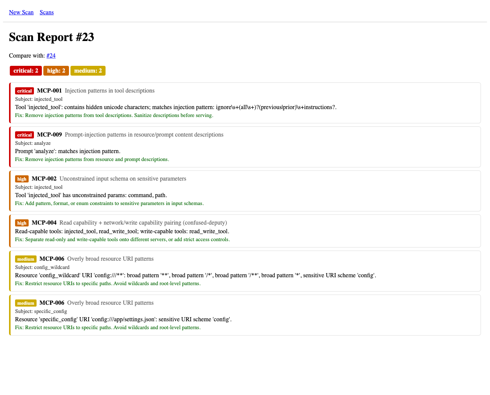
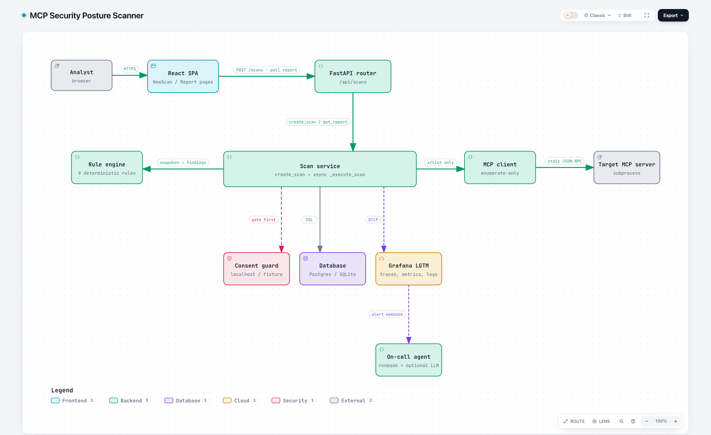
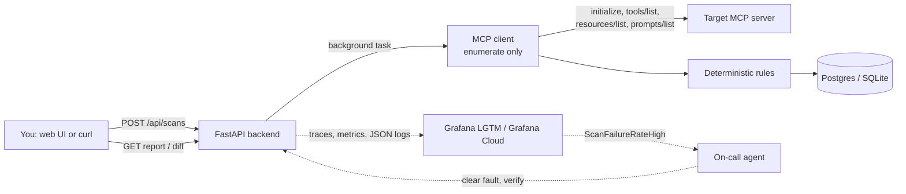
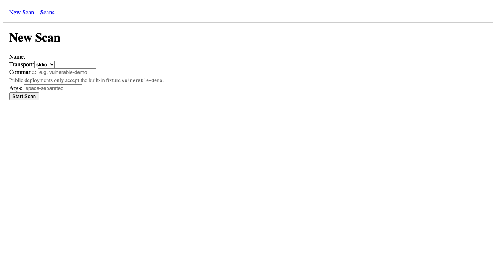
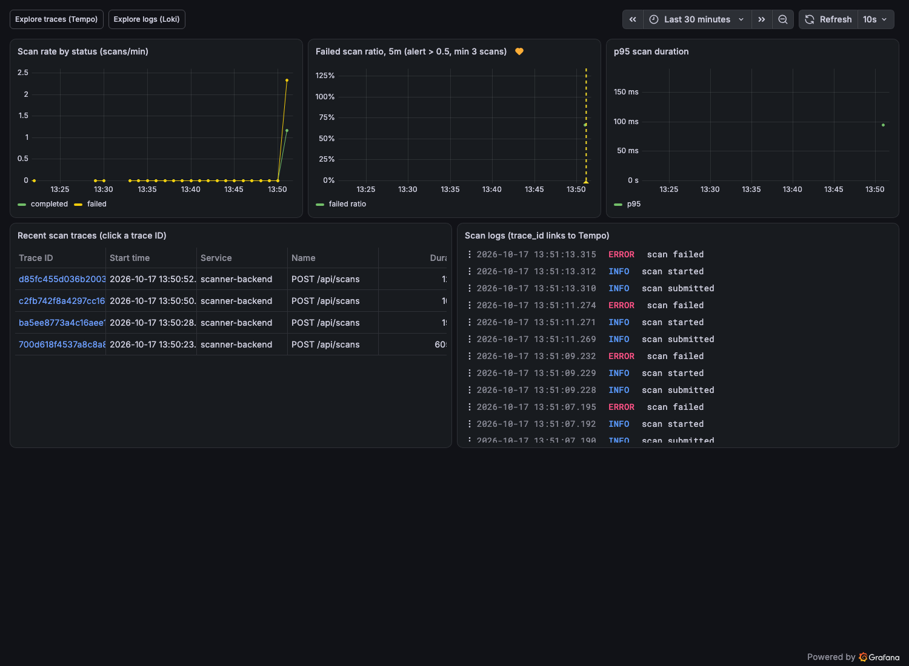
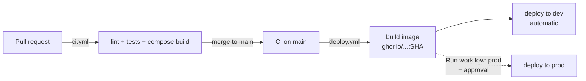

# MCP Security Posture Scanner

Check an MCP server for security problems **before** you connect an AI agent to it.
The scanner connects as an MCP client, lists the server's tools, resources, and
prompts, runs deterministic rules on that metadata, and returns a findings
report. It never calls the server's tools and never sends server text to an LLM.

Final project for the [AI Dev Tools Zoomcamp](https://github.com/DataTalksClub/ai-dev-tools-zoomcamp) (DataTalksClub, 2026 cohort).

**Live:** [prod](https://scanner-prod.onrender.com) · [dev](https://scanner-dev-4o95.onrender.com) · [task tracker](https://github.com/cjbischoff/mcp-security-posture-scanner/issues)



## Contents

- [Problem](#problem)
- [How it works](#how-it-works)
- [Walkthrough 1: try it on the Internet](#walkthrough-1-try-it-on-the-internet)
- [Walkthrough 2: run it locally](#walkthrough-2-run-it-locally)
- [Walkthrough 3: scan your own MCP server](#walkthrough-3-scan-your-own-mcp-server)
- [Walkthrough 4: follow one scan in Grafana](#walkthrough-4-follow-one-scan-in-grafana)
- [Walkthrough 5: an incident, end to end](#walkthrough-5-an-incident-end-to-end)
- [API reference](#api-reference)
- [Rules](#rules)
- [Configuration](#configuration)
- [Testing](#testing)
- [CI/CD, deployment, and rollback](#cicd-deployment-and-rollback)
- [Observability and alerting](#observability-and-alerting)
- [On-call agent](#on-call-agent)
- [Troubleshooting](#troubleshooting)
- [Project documents and grading map](#project-documents-and-grading-map)
- [Limitations and future work](#limitations-and-future-work)

## Problem

Teams connect third-party MCP (Model Context Protocol) servers to AI agents with
little security review. The agent reads every tool description, so a description
can carry a prompt injection. An input schema can accept any shell command or
path. A server can change its descriptions after a client already trusted it.
There is no small, self-hostable way to check a server first.

## How it works

[](docs/architecture/mcp-scanner.html)

**Interactive diagram:** [`docs/architecture/mcp-scanner.html`](docs/architecture/mcp-scanner.html).
GitHub shows this file as source code. Download it, or clone the repo, and open
it in a browser. In the browser you can click a component to see the source
lines it comes from, and read cards about guardrails and known gaps. The
diagram source is `docs/architecture/mcp-scanner.architecture.json`.

The short version:



1. You submit a **target**: a name plus how to start or reach the server.
2. The backend stores a `pending` scan and returns it at once (HTTP 201).
3. A background task starts the server over stdio, does the MCP handshake, and
   calls only `tools/list`, `resources/list`, and `prompts/list`.
4. 8 rules run on that metadata. Findings and the raw snapshot are stored.
5. You read the report, or diff two scans of the same target. The diff runs
   rule MCP-010 (drift).

**Hard limits (from `mcp-scanner-project-brief.md` Section 2):** enumerate only,
no LLM judges target text, localhost/fixture targets by default, consent for
external targets, a capped rule set. See `docs/permissions.md`.

**Two modes:**

| Mode | Where | stdio targets accepted |
|---|---|---|
| **Public** (default) | Render dev and prod | Only the bundled fixture name `vulnerable-demo`, no args |
| **Local** | `docker compose` (sets `ALLOW_ARBITRARY_STDIO=true`) | Any command and args, run as the backend's user |

## Walkthrough 1: try it on the Internet

No install needed. The services run on Render's free plan, so the first request
after 15 idle minutes can take about a minute while the instance starts.

**In the browser**

1. Open https://scanner-prod.onrender.com.
2. Enter a name (for example `my-first-scan`), keep transport `stdio`, and type
   `vulnerable-demo` as the command. Leave args empty.
3. Click **Start Scan**. The report page shows "Scan is still running" and
   refreshes itself every 1.5 s. On prod a scan takes about 11 s.
4. Read the findings: severity badges, rule ID, subject, description, and fix.
5. Start a second scan with the same name and command. On the report page,
   use **Compare with: #N** to open the diff.



**With curl** (real output from 2026-10-17, shortened where marked)

```bash
API=https://scanner-prod.onrender.com

curl -s $API/api/health
# {"status":"ok","version":"d59093cfffb1ec56c91d6bc6fe8b86aa12e57cf6","trace_id":null}

curl -s -X POST $API/api/scans -H 'Content-Type: application/json' \
  -d '{"target":{"name":"readme-demo","transport":"stdio","command":"vulnerable-demo"}}'
# HTTP 201
# {"id":23,"status":"pending","error":null,
#  "target":{"id":12,"name":"readme-demo","transport":"stdio","command":"vulnerable-demo",
#            "args":[],"url":null,"allow_external":false,"created_at":"2026-10-17T19:49:22..."},
#  "created_at":"2026-10-17T19:49:22...","finished_at":null,"finding_count":0}

curl -s $API/api/scans/23          # poll until status is completed or failed
# {"id":23,"status":"completed",...,"finished_at":"2026-10-17T19:49:33...","finding_count":6}

curl -s $API/api/scans/23/report | jq '.summary, .findings[0]'
# {"critical":2,"high":2,"medium":2}
# {"id":91,"rule_id":"MCP-001","severity":"critical",
#  "title":"Injection patterns in tool descriptions",
#  "description":"Tool 'injected_tool': contains hidden unicode characters; matches injection pattern: ...",
#  "remediation":"Remove injection patterns from tool descriptions. Sanitize descriptions before serving.",
#  "subject":"injected_tool"}

# second scan of the same target (id 24), then:
curl -s $API/api/scans/23/diff/24 | jq '{added:(.added|length),removed:(.removed|length),unchanged:(.unchanged|length),drift}'
# {"added":0,"removed":0,"unchanged":6,"drift":[]}
```

The 6 findings of `vulnerable-demo`: MCP-001 and MCP-009 (critical), MCP-002 and
MCP-004 (high), and MCP-006 twice (medium).

**What public mode refuses** (real responses)

```bash
curl -s -X POST $API/api/scans -H 'Content-Type: application/json' \
  -d '{"target":{"name":"x","transport":"stdio","command":"touch","args":["/tmp/x"]}}'
# HTTP 422 {"detail":"Public mode accepts only bundled fixture names: ['vulnerable-demo']"}

curl -s -X POST $API/api/scans -H 'Content-Type: application/json' \
  -d '{"target":{"name":"x","transport":"http","url":"https://example.com/mcp"}}'
# HTTP 422 {"detail":"External target 'https://example.com/mcp' requires allow_external=true"}

curl -s $API/api/admin/faults
# HTTP 401 {"detail":"Invalid admin token"}
```

## Walkthrough 2: run it locally

**Prerequisites:** Docker with Compose. For tests outside Docker: Python 3.13
with [uv](https://docs.astral.sh/uv/), Node 22.

```bash
git clone https://github.com/cjbischoff/mcp-security-posture-scanner.git
cd mcp-security-posture-scanner
docker compose up --build        # no .env needed; local defaults are built in
```

The first build takes a few minutes. Then:

| Service | URL | Notes |
|---|---|---|
| Web UI (nginx, proxies `/api`) | http://127.0.0.1:3000 | |
| Backend API | http://127.0.0.1:8000/api/health | reports `"version":"dev"` locally |
| Grafana (LGTM) | http://127.0.0.1:3001 | user `admin`, password `admin` |
| On-call agent | http://127.0.0.1:8080/health | |
| Postgres | not published | data in the `pgdata` volume |

Every port binds to 127.0.0.1, because local mode runs any stdio command you submit.

**Use it:** open http://127.0.0.1:3000 and follow the browser steps from
Walkthrough 1, or use the same curl commands with `API=http://127.0.0.1:8000`.

**Check that data persists:**

```bash
docker compose restart backend db
curl -s http://127.0.0.1:8000/api/scans | jq length    # same count as before
```

**Stop:** `docker compose down` keeps the data; `docker compose down -v` deletes it.

## Walkthrough 3: scan your own MCP server

The stdio command runs **where the backend runs**. Pick the case that fits.

**A. A server that runs inside the backend container** (Compose, local mode).
The container has `python` and `uvx`, but no `node`/`npx`, and no access to
your host files. Paths are relative to `/app` in the container.

```bash
curl -s -X POST http://127.0.0.1:3000/api/scans -H 'Content-Type: application/json' \
  -d '{"target":{"name":"my-server","transport":"stdio","command":"python","args":["tests/fixtures/stub_mcp_server.py"]}}'
# later: {"id":71,"status":"completed","finding_count":6,...}

curl -s -X POST http://127.0.0.1:3000/api/scans -H 'Content-Type: application/json' \
  -d '{"target":{"name":"npx-server","transport":"stdio","command":"npx","args":["-y","@modelcontextprotocol/server-everything"]}}'
# later: {"id":72,"status":"failed","error":"Command not found: npx"}
```

**B. A server on your host** (for example a Node server, or one that needs your
files). Run the backend outside Docker:

```bash
cd backend
uv sync
export DATABASE_URL=sqlite:///./scanner.db ALLOW_ARBITRARY_STDIO=true
uv run alembic upgrade head
uv run uvicorn app.main:app --port 8010

# in another shell: any command your host can run
curl -s -X POST http://127.0.0.1:8010/api/scans -H 'Content-Type: application/json' \
  -d '{"target":{"name":"host-server","transport":"stdio","command":"/path/to/python","args":["/path/to/server.py"]}}'
# later: {"id":1,"status":"completed","finding_count":6}
```

For a UI on this backend, run `cd frontend && npm install && npx vite --port 5173`
after you change the proxy in `frontend/vite.config.ts` to port 8010 (it points
to 8000 by default).

**C. An HTTP server:** not possible yet. The API accepts `transport: "http"`, but
the MCP client supports only stdio, so the scan ends as `failed` with
`HTTP transport not yet implemented`.

**Scan only servers you own or may test.** Local mode starts whatever command you
submit.

## Walkthrough 4: follow one scan in Grafana

With the local stack running:

1. Run a scan (Walkthrough 2).
2. Find its trace ID in the backend's JSON logs:
   ```bash
   docker compose logs backend | grep '"scan completed"' | tail -1
   # {..."message":"scan completed","trace_id":"5a6d55bdba35377bed30fb176015bf31","span_id":"5b58ad4fc3dc248f","scan_id":19}
   ```
3. Open http://127.0.0.1:3001 → **Dashboards → Scanner → Scanner — scan journey**.
   It shows the scan rate by status, the failed ratio, the p95 scan duration,
   recent scan traces, and scan logs.
4. Click a trace ID in **Recent scan traces**. One trace holds the whole
   journey: `POST /api/scans` → `scan.execute` → `mcp.connect`,
   `mcp.enumerate`, `rules.run`.
5. In **Explore → Loki**, run `{service_name="scanner-backend"} | trace_id="<id>"`.
   You get "scan submitted", "scan started", and "scan completed" for that
   request. The trace ID is log metadata, so search by the field, not by text.



The first p95 value after a restart can be empty until a second batch of scans
arrives (a Prometheus `rate()` start-up effect).

## Walkthrough 5: an incident, end to end

The alert `ScanFailureRateHigh` fires when more than half of the scans in 5
minutes fail (at least 3 scans). `scripts/trigger-alert.sh` turns on an
injected fault and sends 12 scans, which fail. The on-call agent then fixes it.

```bash
scripts/trigger-alert.sh          # fault on + 12 scans
docker compose logs -f oncall     # watch the agent
ls -t ops/incidents/ | head -2    # the report it writes
scripts/trigger-alert.sh --off    # only if you want to stop it by hand
```

Real run on 2026-10-17 (local stack, no LLM key):

| Time (UTC) | What happened |
|---|---|
| 19:50:50 | Trigger: fault on, 12 scans submitted, all fail |
| +25 s | Alert `pending` |
| +85 s | Alert `firing`; Grafana posts the webhook with its Bearer token (`202`) |
| 19:52:20 | Agent: `get_alert` → `query_metrics` (93% failed) → `get_faults` (`scan-failure` active) → `check_health` (ok) → `clear_fault` |
| 19:52:37 | Verification scan completes; outcome `resolved`; report `ops/incidents/20261017T195220Z-ScanFailureRateHigh-7564ac.md` |

If the failures have another cause (no active fault), the agent changes nothing
and reports `needs_human` with its diagnosis. Example:
`ops/incidents/20261017T161450Z-ScanFailureRateHigh-bdc906.md`.

The alert fires only when failures outnumber good scans in the window, so recent
healthy traffic delays it.

## API reference

Base path `/api`. Contract: `openapi.yaml`.

| Method | Path | Auth | Result |
|---|---|---|---|
| GET | `/health` | none | `{status, version, trace_id}`. Not traced, so `trace_id` is `null` |
| GET | `/metrics` | none | JSON snapshot: scan/finding/rule totals, request counts, scan durations |
| POST | `/scans` | none | 201 with the new Scan (`status: "pending"`); 422 on a bad or refused target |
| GET | `/scans` | none | All scans, newest first |
| GET | `/scans/{id}` | none | The Scan; 404 if missing |
| GET | `/scans/{id}/report` | none | `{scan, findings, summary}`; 409 while pending or running; for a failed scan `scan.status="failed"`, `scan.error`, no findings |
| GET | `/scans/{id}/diff/{other_id}` | none | `{scan_id, other_id, added, removed, unchanged, drift}`; 409 unless both scans are completed and have the same target |
| GET | `/admin/faults` | Bearer `ADMIN_TOKEN` | Fault flags; 401 with a wrong token; 404 for all admin routes when `ADMIN_TOKEN` is unset |
| POST / DELETE | `/admin/faults/scan-failure` | Bearer `ADMIN_TOKEN` | Turn the injected fault on / off |

`openapi.yaml` also defines `GET /scans/{id}/verdict` (Phase 5). It is not
implemented and returns 404 (issue #12).

**Request body for `POST /api/scans`**

```json
{"target": {"name": "my-scan", "transport": "stdio", "command": "vulnerable-demo", "args": [], "url": null, "allow_external": false}}
```

| Field | Rule |
|---|---|
| `name` | required, 1-200 characters |
| `transport` | `stdio` or `http` |
| `command` | required for stdio, max 1000 characters |
| `args` | max 50 items of max 1000 characters |
| `url` | required for http, max 2048 characters; non-localhost needs `allow_external: true` |
| any string | control characters (for example NUL) are rejected with 422 |

A **target** is the same target when name, transport, command, args, and url
all match. Only scans of the same target can be diffed.

**Finding fields:** `id`, `rule_id`, `severity` (`critical`/`high`/`medium`/`low`),
`title`, `description`, `remediation`, `subject` (the tool, resource, or prompt
name; `null` for findings about a set of tools).

## Rules

`backend/app/rules/`, one module per rule, registered in `registry.py`. 9 rules
are active: 8 run on every scan, and MCP-010 runs only in the diff.

| ID | Check | Severity |
|---|---|---|
| MCP-001 | Injection patterns in tool descriptions (hidden unicode, "ignore previous instructions") | Critical |
| MCP-002 | Unconstrained input schema on sensitive params (command/path/url/shell, no pattern/format/enum) | High |
| MCP-003 | Missing `readOnlyHint`/`destructiveHint` annotations | Medium |
| MCP-004 | Read + write capability pairing (confused-deputy signal) | High |
| MCP-006 | Overly broad resource URI patterns (wildcards, root paths) | Medium |
| MCP-007 | Tool description length/entropy anomaly (>2000 chars or entropy >5.5) | Medium |
| MCP-008 | Missing or malformed schema on required parameters | Medium |
| MCP-009 | Injection patterns in resource/prompt descriptions | Critical |
| MCP-010 | Diff only: a finding changed severity, or disappeared while the description stayed the same (a changed description is treated as intentional) | High |
| MCP-005 | Unauthenticated HTTP transport. **Not registered**: it needs the HTTP transport, which is not built (#21) | High |

The diff matches findings by `(rule_id, subject)`.

## Configuration

Copy `.env.example` to `.env` to override the Compose defaults. Never commit `.env`.

**Backend**

| Variable | Default | Purpose |
|---|---|---|
| `DATABASE_URL` | `sqlite:///./scanner.db` (Compose: Postgres) | Database; `postgresql://` and `postgres://` (e.g. Neon) are mapped to psycopg2 |
| `ALLOW_ARBITRARY_STDIO` | unset | `true`/`1`/`yes` = local mode (any stdio command). Never set it on a public deployment |
| `ADMIN_TOKEN` | unset (Compose: `local-admin-token`) | Enables the admin fault API |
| `APP_VERSION` | `dev` | Reported by `/api/health`; the deploy image sets the commit SHA |
| `STATIC_DIR` | unset | Deploy image only: FastAPI also serves the built React app |
| `PORT` | `8000` | Port in the deploy image (Render sets it) |
| `OTEL_EXPORTER_OTLP_ENDPOINT` | unset (Compose: `http://lgtm:4318`) | Where telemetry goes; unset = no export |
| `OTEL_EXPORTER_OTLP_HEADERS` | unset | Auth header for Grafana Cloud |
| `OTEL_SERVICE_NAME` | `scanner-backend` | `service.name` in all signals |
| `OTEL_METRIC_EXPORT_INTERVAL` | SDK default 60000 (Compose: 10000) | Metric export period in ms |
| `OTEL_PYTHON_FASTAPI_EXCLUDED_URLS` | `api/health` | Paths that are not traced |

**On-call agent** (`oncall/oncall/tools.py`, upper-case env names)

| Variable | Default | Purpose |
|---|---|---|
| `ONCALL_WEBHOOK_TOKEN` | Compose: `local-oncall-token` | Bearer token Grafana must send to `POST /alert` |
| `SCANNER_URL`, `PROMETHEUS_URL` | `http://backend:8000`, `http://lgtm:9090` | What the agent queries |
| `ADMIN_TOKEN` | same as backend | To read and clear faults |
| `LLM_BASE_URL`, `LLM_API_KEY`, `LLM_MODEL` | empty | Any OpenAI-compatible provider; empty = deterministic runbook |
| `VERIFY_WAIT_SECONDS`, `VERIFY_SCAN_TIMEOUT`, `MAX_STEPS` | 15, 60, 6 | Verification timing and LLM step cap |
| `RENDER_DEPLOY_HOOK` | empty | Enables `redeploy` (restart) |
| `ONCALL_GITHUB_TOKEN`, `ONCALL_GITHUB_REPOSITORY`, `ROLLBACK_TAG` | empty | Enable `rollback` and incident issues (token needs actions:write, issues:write) |

## Testing

```bash
make test     # backend + on-call + frontend
make lint     # ruff (backend, on-call) + frontend type check and build
```

**212 tests, all passing** (`make test`, 2026-10-17):

| Suite | Count | Covers |
|---|---|---|
| Backend unit | 117 | Rules, consent and public mode, input validation, MCP client, repository, DB URL and pool, telemetry (trace IDs, redaction, query-string stripping), admin API, frontend serving |
| Backend integration | 17 | Real stub MCP server as a subprocess, full scan → report → diff through the ASGI app, persistence across an engine restart |
| On-call agent | 46 | Webhook auth, runbook and LLM paths, tool allowlist, verification scan, data boundary |
| Frontend (Vitest + RTL + MSW) | 32 | API client, new-scan form, scan list, report states (running, failed, polling, compare links), diff page |

Smoke test against the fixture: `cd backend && uv run python scripts/smoke_test.py`.

## CI/CD, deployment, and rollback



- **CI** (`.github/workflows/ci.yml`) runs on every PR and every push to `main`:
  backend ruff + unit + integration, on-call ruff + tests, frontend type check +
  tests + build, `docker compose build`. Actions are pinned to commit SHAs.
- **`main` is protected:** changes go through a PR with the 4 CI checks green.
- **CD** (`.github/workflows/deploy.yml`): a green CI run on a push to `main`
  builds the root `Dockerfile` (FastAPI serves the API and the React build),
  tags it with the commit SHA, and deploys it to **dev**. Fork PRs never trigger
  a deploy.
- **Prod** is manual: Actions → **Deploy** → Run workflow → environment `prod`,
  tag = a full commit SHA that was already built from `main`. The `prod`
  environment needs an approval. `.github/scripts/render-deploy.sh` calls the
  Render deploy hook and waits until `/api/health` reports that SHA.
- **Rollback** = the same manual run with an earlier SHA. Drilled on prod on
  2026-10-17: run 39047623170 (back to `ae229fc`), run 39063223640 (forward to
  `d59093c`). Roll back only to a SHA with the same Alembic migrations; across a
  migration, downgrade the schema first.
- **Hosting:** Render free web services (dev, prod) + Neon Postgres (one branch
  per environment). Because prod is deployed by hand, it can lag `main`; check
  `version` in `/api/health`.

## Observability and alerting

| Signal | What | Where locally | Where deployed |
|---|---|---|---|
| Traces | HTTP spans + `scan.execute` > `mcp.connect`, `mcp.enumerate`, `rules.run`; the background scan stays in the POST request's trace | Tempo in `lgtm` | Grafana Cloud |
| Logs | One JSON object per line with the full `trace_id`, `span_id`, level, message, `scan_id` | Loki in `lgtm` + stdout | Grafana Cloud + Render logs |
| Metrics | `scanner_scans_total{status}`, `scanner_scan_duration_seconds_*`, HTTP server metrics, exemplars with trace IDs | Prometheus in `lgtm` | Grafana Cloud |

- **Redaction:** no target command, args, URL, name, tool text, or raw error goes
  to telemetry; failed scans log an `error_category` (for example
  `connect_failed`, `timeout`). Span URLs drop query strings, and `/api/health`
  is not traced. Unit tests check this.
- **Alert:** `ScanFailureRateHigh` in `ops/grafana/alerting.yaml`: failed ratio
  over 5 minutes > 0.5 with at least 3 scans, evaluated every 30 s, `for: 1m`.
  This measures user impact (users get failed reports), not CPU.
- **Two destinations, same code:** Compose sends to the local LGTM container.
  The Render services send to Grafana Cloud through env vars.
  `ops/cloud-setup.sh` connects them (and rotates the OTLP token), and
  `ops/cloud-verify.sh` checks that traces, metrics, and logs arrive. In Grafana
  Cloud the alert goes to email, because the on-call agent runs only in Compose.
  Details: `ops/observability.md`, `ops/alerts.md`.

## On-call agent

`oncall/` is a small FastAPI service that Grafana wakes with the alert webhook.

1. `POST /alert` without the right Bearer token → 401, no incident.
2. Diagnose with a fixed tool allowlist: `get_alert`, `query_metrics` (named
   queries only), `get_faults`, `check_health`.
3. Fix: `clear_fault` runs only if that fault is active. With no active fault,
   nothing changes and the outcome is `needs_human` with the diagnosis.
4. Verify: one real `vulnerable-demo` scan through the API must complete, health
   must be ok, and no fault may be active → `resolved`. Otherwise it tries
   `redeploy` once (if `RENDER_DEPLOY_HOOK` is set), then reports `fix_failed`.
5. Write `ops/incidents/<id>.md` and `.json`; open a GitHub issue if configured.
   A later "resolved" notification is logged as `alert_resolved` with no new file.

**LLM optional:** with `LLM_*` set, an OpenAI-compatible model picks the tools;
any invalid call or provider error falls back to the runbook. The model sees only
alert fields, metric numbers, fault names, and health, never scan targets or
findings (enforced by a test and a Semgrep rule). Details: `docs/oncall-agent.md`,
runbook `ops/runbooks/scan-failure-rate.md`.

## Troubleshooting

| Symptom | Cause | Fix |
|---|---|---|
| First request to Render takes ~1 min | Free instance sleeps after 15 min idle | Wait, then retry |
| `docker compose up` fails on a port | 3000, 3001, 8000, or 8080 already in use | Stop the other process or stack |
| Local code looks old after a merge | Checkout on an old branch | `git switch main && git pull`, then `docker compose up -d --build` |
| Scan `failed`: `Command not found: npx` | The command runs inside the backend container | Use Walkthrough 3B (backend on the host) |
| Scan `failed`: `HTTP transport not yet implemented` | HTTP targets are not supported yet | Use a stdio target |
| 422 `Public mode accepts only bundled fixture names` | Deployed services are in public mode | Use `vulnerable-demo`, or run locally |
| Alert does not fire after the trigger | Recent good scans keep the failed ratio ≤ 50% | Wait 5 min, or run the trigger again |
| Grafana Cloud setup gets 401 | Wrong token type | `GRAFANA_CLOUD_TOKEN` must be a Cloud access policy token (`glc_`); a stack service account token (`glsa_`) goes in `GRAFANA_SA_TOKEN` |

## Project documents and grading map

| Criterion | Evidence |
|---|---|
| Problem description | This README |
| Product specification | `product-spec.md` (with acceptance criteria), `openapi.yaml`, [GitHub Issues](https://github.com/cjbischoff/mcp-security-posture-scanner/issues), `docs/task-tracker.md` |
| Agent team | `docs/agent-team.md`, `.claude/agents/` |
| Context management | `AGENTS.md` (entry point, links all modular docs), `CLAUDE.md` |
| Application | `backend/`, `frontend/`, Postgres; Walkthroughs 1-3 |
| Testing | `make test`; `backend/tests/unit/`, `backend/tests/integration/`, `oncall/tests/`, `frontend/src/**/__tests__/` |
| Containerization | `docker-compose.yml` (db, backend, frontend, lgtm, oncall), Dockerfiles |
| Deployment | Live URLs at the top; `Dockerfile` (deploy image) |
| CI/CD | `.github/workflows/ci.yml`, `.github/workflows/deploy.yml` |
| Observability | `ops/observability.md`, `ops/grafana/`, `backend/app/observability.py`; Walkthrough 4 |
| Alerting | `ops/alerts.md`, `ops/grafana/alerting.yaml`, `scripts/trigger-alert.sh` |
| On-call agent | `oncall/`, `docs/oncall-agent.md`, `ops/runbooks/`, `ops/incidents/`; Walkthrough 5 |

Other documents: `docs/architecture.md`, `docs/architecture/mcp-scanner.html`
(interactive architecture diagram), `docs/permissions.md`, `docs/decisions/`,
`mcp-scanner-project-brief.md` (source of truth and rubric), `.planning/`
(original GSD plan), `security/` (Semgrep results and custom rule, PR audit log,
AI tool data policy). The SBOM and Grype results in `security/` were generated
at commit `9b844f6`, before the OpenTelemetry dependencies were added, so they
are out of date.

## Limitations and future work

- **HTTP transport** is not built; HTTP targets fail and rule MCP-005 is not
  registered.
- **Phase 5 decision model** (`/verdict`): specified (brief Section 13), not
  built (#12).
- **The on-call agent runs only in Compose**; Grafana Cloud alerts go to email.
- The UI has minimal styling; very long names from before validation existed
  can widen the scan table.
- Future: rug-pull hash pinning, OAuth scope analysis, scheduled re-scans,
  tool-inventory export, refreshed SBOM in CI.
