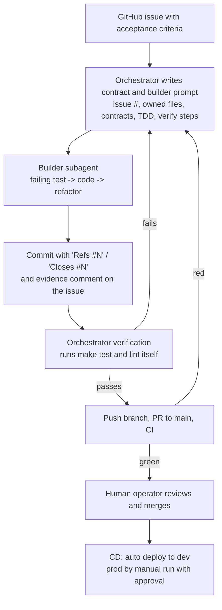

# Agent Team Specification

How the AI agents and the human operator built this project together. This
is the development team. The `oncall/` responder agent is part of the
product, not the team; see [`oncall-agent.md`](oncall-agent.md).

Tracker: [GitHub Issues](https://github.com/cjbischoff/mcp-security-posture-scanner/issues)
(see [`task-tracker.md`](task-tracker.md)).

## Roles

| Role | Who / tool | Responsibilities | Inputs | Outputs | Permissions and limits |
|---|---|---|---|---|---|
| Human operator | Project owner | Decides scope and trade-offs (hosting, LLM approach), reviews and merges PRs, approves prod deploys | Audit reports, PRs, CI results, questions from the orchestrator | Decisions, merges to `main`, prod approvals | Only the operator merges to `main` (a working rule; see Merges below). The GitHub environment `prod` has a required reviewer |
| Orchestrator | Claude Code main session | Audits the repo, writes contracts (metric names, API shapes, file ownership), opens and maintains issues, writes builder prompts, runs verification itself (`make test`, CI), commits and pushes, asks the operator for decisions | Brief, `CLAUDE.md`, `openapi.yaml`, issues, subagent reports | Issues with acceptance criteria, subagent prompts, verified commits, PRs, tracker comments | Never pushes to `main`; never merges; asks before scope changes |
| Builder | Claude Code general-purpose subagent, one per work stream ([`.claude/agents/builder.md`](../.claude/agents/builder.md)) | Implements one issue test-first; comments evidence on the issue | Written prompt: issue number, contracts, owned files, TDD rule, verification commands | Tests and code in its owned files, verification output, issue comment | Edits only its owned files. Builders run in parallel only when file ownership does not overlap |
| Auditor | Claude Code subagent, read-only ([`.claude/agents/auditor.md`](../.claude/agents/auditor.md)) | Repo vs spec consistency review, CI and scaffold review, rubric scoring audits | Repo, brief Section 9, rubric | Findings with `file:line` evidence | Read-only tools; no edits, commits, or pushes |
| Researcher | Claude Code subagent ([`.claude/agents/researcher.md`](../.claude/agents/researcher.md)) | Technical research, for example the free hosting comparison | One research question | Sourced comparison table and recommendation (raw sources in `.firecrawl/`, gitignored) | No project edits; the operator makes the choice |
| GSD planners (earlier phase) | GSD (get-shit-done) roles via the omp CLI: doc ingest, roadmapper, planner, checker | Turned the brief and specs into a roadmap, requirements, and phase plans | Brief, `product-spec.md`, `docs/`, ADRs | [`.planning/`](../.planning/) (`PROJECT.md`, `REQUIREMENTS.md`, `ROADMAP.md`, phase plans) | Planning artifacts only |

## Handoff process

1. The orchestrator (or an audit) finds a gap and opens an issue with an
   acceptance-criteria checklist and `area:*` / `agent:*` labels.
2. The orchestrator fixes the contracts before any code: metric names, API
   shapes, webhook URLs, env vars, and which files each builder owns.
3. Each builder gets a written prompt with those contracts, the TDD rule,
   its owned files, the verification commands, and the issue number.
   Independent streams run in parallel (for example observability and the
   on-call agent were built at the same time against an agreed webhook URL,
   metric names, and admin fault API).
4. The builder reports evidence back and comments on its issue.
5. The orchestrator does not trust the report: it runs `make test`, lint, and
   the compose demo itself, then commits and pushes.
6. CI runs on the PR. The human operator reviews and merges. CD deploys
   green `main` to dev; prod is a manual run that needs approval.

## Rules every agent follows

- `mcp-scanner-project-brief.md` Section 2 is non-negotiable: deterministic
  rule engine (no target descriptions or schemas to an LLM), localhost and
  fixture targets by default, enumerate only, clean-room, rule set capped at
  about 10-12 checks.
- TDD: a failing test before production code.
- File ownership: a builder edits only the files in its prompt.
- Commits: conventional format, signed, `Refs #N` / `Closes #N`, no AI
  attribution of any kind.
- Never push to `main`; merges and prod deploys are gated on the human.
- Evidence over claims: work is done when the real commands pass.

## Evidence

| Work stream | Agent | Issue | Evidence |
|---|---|---|---|
| Persistence | Builder | [#6](https://github.com/cjbischoff/mcp-security-posture-scanner/issues/6) | Commits `36d3453`, `de6d6d8`; [closing comment](https://github.com/cjbischoff/mcp-security-posture-scanner/issues/6#issuecomment-6225693857) |
| Observability | Builder | [#7](https://github.com/cjbischoff/mcp-security-posture-scanner/issues/7) | Commits `58e4b7c`, `84f7f0a`, `7c86fdc`; [verification comment](https://github.com/cjbischoff/mcp-security-posture-scanner/issues/7#issuecomment-6225850162) (one trace ID across Tempo, Loki, Prometheus) |
| Alerting | Builder | [#8](https://github.com/cjbischoff/mcp-security-posture-scanner/issues/8) | Commits `58e4b7c`, `84f7f0a`; [verification comment](https://github.com/cjbischoff/mcp-security-posture-scanner/issues/8#issuecomment-6225850483) |
| On-call agent | Builder (parallel with #7/#8) | [#9](https://github.com/cjbischoff/mcp-security-posture-scanner/issues/9) | Commits `e53b039`, `aeae48c`, `ce6365f`; [verification comment](https://github.com/cjbischoff/mcp-security-posture-scanner/issues/9#issuecomment-6225856794); incident report `ops/incidents/20261016T222020Z-ScanFailureRateHigh-ceb72b.md` |
| Public-mode stdio fix, CI, CD | Orchestrator | [#4](https://github.com/cjbischoff/mcp-security-posture-scanner/issues/4), [#5](https://github.com/cjbischoff/mcp-security-posture-scanner/issues/5), [#10](https://github.com/cjbischoff/mcp-security-posture-scanner/issues/10) | Commits `a3513bb`, `00c9eb9`, `45923ef` |
| Docs and tracker | Orchestrator | [#11](https://github.com/cjbischoff/mcp-security-posture-scanner/issues/11) | This file, `task-tracker.md`, README |
| Planning | GSD roles | — | `.planning/ROADMAP.md`, `.planning/phases/` |

### How the tracker was used (timestamps)

Times are UTC, from `gh issue list --state all --json number,createdAt,closedAt`
and `git log --format='%h %aI %s'`.

| Issues | Opened | Their commits | What this shows |
|---|---|---|---|
| #2-#6 | 2026-10-16 22:12:01-22:12:06 | 19:13:03 (`9b844f6`, `22fecd4`, one batch), 21:59:09 (`a3513bb`, `00c9eb9`), 22:08:20 (`36d3453`) | Back-filled. Each issue was closed 20-30 seconds after it was opened, with an evidence comment. The work came first. |
| #7-#10 | 2026-10-16 22:12:35-22:12:40 | #7-#9: one batch at 22:23:32-22:25:04 (`58e4b7c` to `ce6365f`). #10: `45923ef` (22:04:31) and `668eb91` (22:10:18) before the issue, `5f8a9a8` (22:55:17) after | Mostly back-filled. The verification comments on #7-#9 record working runs at 22:19-22:20, 7-8 minutes after the issues were opened, so most of the code existed before them. The issues were written while the work was finishing, not before it started. |
| #11, #12 | 2026-10-16 22:12:42-22:12:43 | #11: 22:31:48. #12: spec only (`f802f9b`, 2026-10-15) | #11 came before its commits. #12 is the open Phase 5 backlog item. |
| #14 | 2026-10-16 23:19:20 | 23:19:27 (`b62af72`) to 2026-10-17 14:05:47 (`a48d5b9`) | Opened 7 seconds before its first commit; the later commits reference it. |
| #18-#26 | 2026-10-17 | PRs #16, #17, #27 | Opened from the 2026-10-17 adversarial review. #18-#20 record PRs #27, #16, and #17; #16 and #17 merged before these issues were opened. #21-#26 are backlog. |

All issues #2-#12 were opened within 43 seconds of each other, when the
tracker moved to GitHub Issues. Commits `58e4b7c` (2026-10-16) through
`a48d5b9` (2026-10-17) reference their issues (`git log --grep "#"`). The
2026-10-17 fix commits in PRs #16, #17, and #27 (`be1ca1b`, `47cacb7`,
`56800c6`, `b6f2d2f`, `8fbcfc4`) do not reference an issue; #18-#20 were
opened while those PRs were in flight or after they merged. Issue
comments are posted with the operator's `gh` credentials, so they show the operator's account.

### Merges

Merges to `main` are made from the operator's account (`cjbischoff`;
`gh pr list --state merged --json number,mergedBy`). Until 2026-10-17 `main` had no branch protection, so "only the operator
merges" was a working rule. Since 2026-10-17 GitHub enforces it: `main`
requires a pull request and green `backend`, `frontend`, `oncall` and
`compose-build` checks, and blocks force pushes and deletion (`gh api
repos/cjbischoff/mcp-security-posture-scanner/branches/main/protection`;
issue [#20](https://github.com/cjbischoff/mcp-security-posture-scanner/issues/20)).
No approving review is required, because the operator is the only
maintainer and GitHub does not count self-approval. Admins are not
enforced, so the operator can still bypass in an emergency. The `prod` environment
needs an approval, but its only reviewer is the operator and self-review is
allowed.
