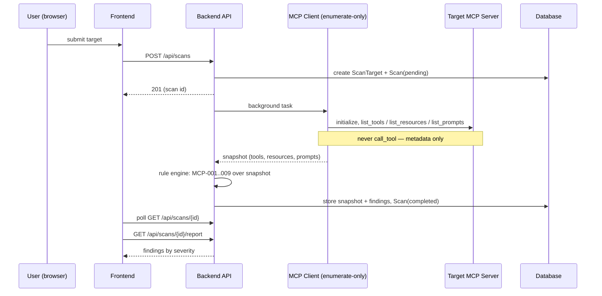
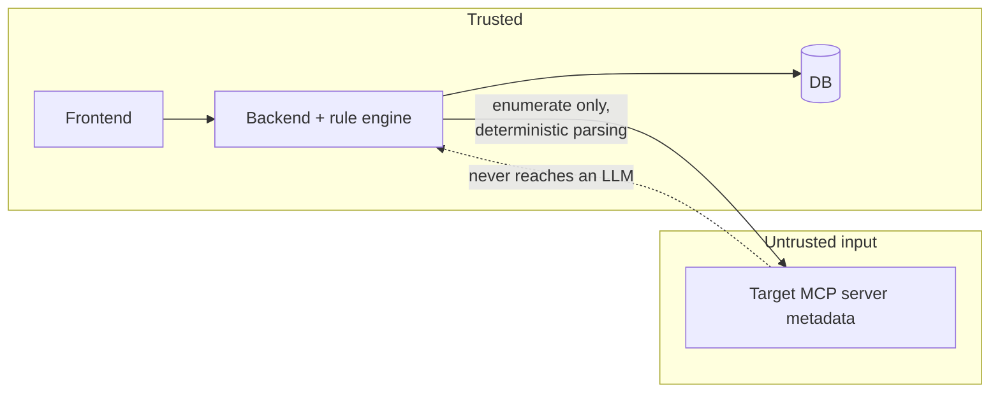

# Architecture

Planned system architecture (Phase 0 — updated as implementation lands).

## Components

- **Frontend** — React + TypeScript (Vite). All backend calls go through one
  centralized API client (`frontend/src/api/`). Pages: submit scan, scan
  list/status, findings report, scan diff.
- **Backend** — FastAPI. Layered: routers → services → repositories →
  SQLAlchemy models. Two special modules:
  - `app/mcp_client/` — connects to a scan target over stdio or streamable
    HTTP and **only enumerates** tools/resources/prompts.
  - `app/rules/` — deterministic rule engine, one module per rule (capped at
    10 for v1), run over the enumerated snapshot. No LLM involvement.
- **Database** — SQLite locally, Postgres in prod, selected via
  `DATABASE_URL`. Alembic migrations.
- **Containerization** — Docker Compose: `frontend` (nginx, proxies `/api`),
  `backend` (uvicorn :8000), `db` (Postgres 16).
- **CI/CD** — GitHub Actions: `ci.yml` lints and runs unit + integration
  tests on every push/PR; `deploy.yml` deploys on merge to main after CI
  passes; `security-scan.yml` (Phase 3) runs Semgrep incl. the custom
  `no-llm-on-untrusted-mcp-data` rule.

## Scan flow

## Diff / drift detection

`GET /api/scans/{id}/diff/{other_id}` compares two completed scans of the
same target: findings keyed by `(rule_id, subject)` produce added/removed/
unchanged sets; rule MCP-010 flags findings that changed severity or
disappeared **without** a corresponding description change in the stored
snapshots — the "rug pull" signal.

## Trust boundaries

Target-server metadata is treated as hostile input: parsed by deterministic
rules, rendered inertly in the UI, never forwarded to any LLM API.
