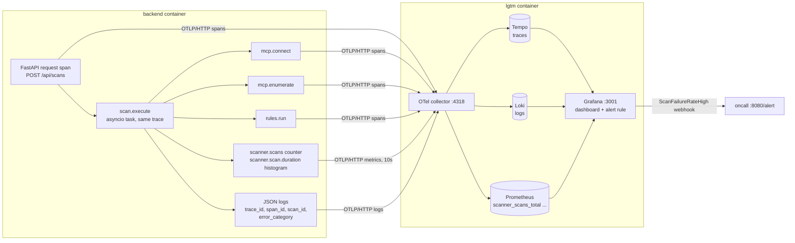
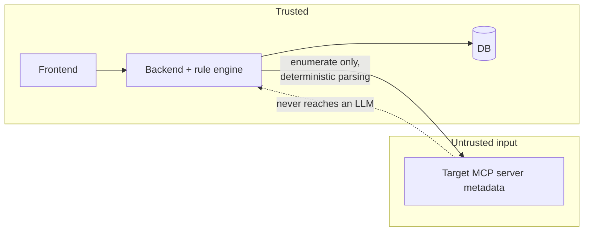
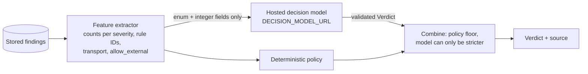

# Architecture

Planned system architecture (Phase 0 — updated as implementation lands).

For the diagram of the code as built, open `architecture/mcp-scanner.html` in
a browser. Each component in it links to its source lines.

## Components

- **Frontend** — React + TypeScript (Vite). All backend calls go through one
  centralized API client (`frontend/src/api/`). Pages: submit scan, scan
  list/status, findings report, scan diff.
- **Backend** — FastAPI. Layered: routers → services → repositories →
  SQLAlchemy models. Two special modules:
  - `app/mcp_client/` — connects to a scan target over stdio or streamable
    HTTP and **only enumerates** tools/resources/prompts.
  - `app/rules/` — deterministic rule engine, one module per rule (capped at
    10 for v1), run over the enumerated snapshot. No LLM involvement.
- **Database** — SQLite locally, Postgres in prod, selected via
  `DATABASE_URL`. Alembic migrations run at container start
  (`alembic upgrade head`).
- **Containerization** — Docker Compose: `frontend` (nginx, proxies `/api`),
  `backend` (uvicorn :8000), `db` (Postgres 16), `lgtm` (Grafana
  `otel-lgtm`: OTel collector, Tempo, Loki, Prometheus, Grafana on
  127.0.0.1:3001), `oncall` (alert responder).
- **Observability** — OpenTelemetry SDK in the backend exports traces,
  metrics, and logs over OTLP/HTTP to `lgtm`. Grafana alerting posts
  `ScanFailureRateHigh` to the `oncall` webhook. See `ops/observability.md`
  and `ops/alerts.md`.
- **CI/CD** — GitHub Actions: `.github/workflows/ci.yml` lints and runs backend unit +
  integration tests, oncall tests, frontend type check, tests, and build, and
  `docker compose build`, on every PR and push to main; `.github/workflows/deploy.yml` deploys
  to dev after CI passes on main, and to prod only by a manual run with
  approval. Semgrep (standard rule packs and the custom rules in
  `security/semgrep/rules/`, including `no-llm-on-untrusted-mcp-data`) does
  not run in CI; it runs by hand in the `security/` container, and its
  results are committed in `security/semgrep/`.

## Scan flow

```mermaid
sequenceDiagram
    participant U as User (browser)
    participant F as Frontend
    participant B as Backend API
    participant M as MCP Client (enumerate-only)
    participant T as Target MCP Server
    participant D as Database

    U->>F: submit target
    F->>B: POST /api/scans
    B->>D: create ScanTarget + Scan(pending)
    B-->>F: 201 (scan id)
    B->>M: background task
    M->>T: initialize, list_tools / list_resources / list_prompts
    Note over M,T: never call_tool — metadata only
    M-->>B: snapshot (tools, resources, prompts)
    B->>B: rule engine: MCP-001..009 over snapshot
    B->>D: store snapshot + findings, Scan(completed)
    F->>B: poll GET /api/scans/{id}
    F->>B: GET /api/scans/{id}/report
    B-->>F: findings by severity
```

## Telemetry flow

Only scan_id, transport, status, counts, durations, and an error category
cross into telemetry. Target command, args, URL, name, tool metadata, and raw
error text do not.

## Diff / drift detection

`GET /api/scans/{id}/diff/{other_id}` compares two completed scans of the
same target: findings keyed by `(rule_id, subject)` produce added/removed/
unchanged sets; rule MCP-010 flags findings that changed severity or
disappeared **without** a corresponding description change in the stored
snapshots — the "rug pull" signal.

## Trust boundaries

Target-server metadata is treated as hostile input: parsed by deterministic
rules, rendered inertly in the UI, never forwarded to any LLM API.

## Decision model (Phase 5, operator-requested)

`GET /api/scans/{id}/verdict` returns `allow`/`review`/`block`, a 0-100
score, the rule IDs behind it, and its `source`. It runs after the rule
engine and reads only the stored findings. The rule engine does not change.

- **Input boundary:** a typed request model with no free-text fields. Names,
  descriptions, schemas, finding text, URLs and commands cannot be sent.
- **Fallback:** if the model is unset, times out, or returns an invalid
  response, the deterministic policy produces the verdict (`source: policy`).
- **Policy floor:** any Critical finding is always `block`.
- Full spec: brief Section 13.
