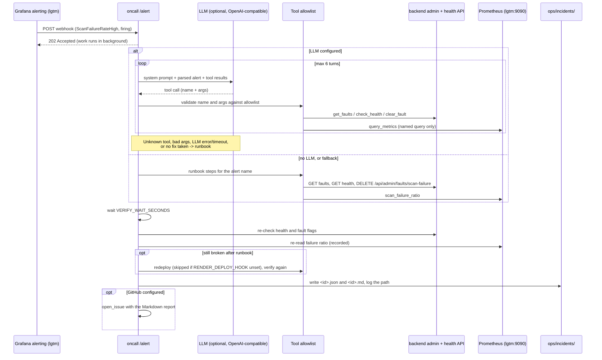

# On-call responder agent

The `oncall` service wakes up when Grafana fires an alert, finds the cause,
fixes it, checks that the fix worked, and writes an incident report.

Code: `oncall/` (its own uv project; FastAPI + httpx, no LLM SDK).
Runbook it follows: `ops/runbooks/scan-failure-rate.md`.

## Flow



## Tools (fixed allowlist)

The model gets these tool specs and nothing else. The server validates every
call: unknown names, extra or missing arguments, and values outside the
allowed set are rejected, and the agent falls back to the runbook.

| Tool | Args | What it does |
|---|---|---|
| `get_alert` | none | Parsed alert: name, status, severity, service, start time, numeric values, summary |
| `query_metrics` | `name`: `scan_failure_ratio`, `scan_rate`, `scan_duration_p95` | Runs a fixed PromQL query; returns numbers only |
| `get_faults` | none | Names of active injected faults |
| `check_health` | none | `/api/health` status, version, HTTP code |
| `clear_fault` | `name`: `scan-failure` | `DELETE /api/admin/faults/scan-failure` |
| `redeploy` | none | POST the Render deploy hook (same image = restart); skipped if unset |
| `rollback` | none | `workflow_dispatch` of `deploy.yml` with `ROLLBACK_TAG`; skipped if unset |

`open_issue` is not offered to the model. The agent calls it after
verification, with the incident report as the issue body.

The model cannot write PromQL, choose URLs, or pick a rollback tag. Those are
fixed in code or config.

## Runbook fallback

Used when no LLM is configured, or when the LLM errors, times out, asks for a
tool or argument that is not allowed, hits the step cap, or finishes without a
fix. A fresh clone with no key still fixes the demo incident this way.

| Alert | Actions, in order |
|---|---|
| `ScanFailureRateHigh` | `get_alert`, `query_metrics(scan_failure_ratio)`, `get_faults`, `check_health`, `clear_fault(scan-failure)`; if verification fails, `redeploy` |
| any other | diagnostics only, outcome `needs_human` |

Resolved alerts are logged and take no action.

## Verification

After a fix, the agent waits `VERIFY_WAIT_SECONDS`, then checks:

- `/api/health` returns 200 with `status: ok`
- `GET /api/admin/faults` shows no active `scan-failure`

Both must hold for outcome `resolved`, else `unresolved`. The failure ratio is
recorded but not required to drop, because it is a 5-minute rate and stays
high for a few minutes after the cause is gone. Grafana sends `resolved` when
it does.

## Data boundary

Brief Section 2, item 1: target-server data never reaches an LLM. The agent
sees only:

- the alert payload, reduced to name, status, severity, service, start time,
  numeric values, and a 200-character summary (URLs and fingerprints dropped)
- metric numbers (labels dropped)
- fault flag names whose value is `true`
- health `status`, `version`, and HTTP code

Each tool builds a small typed result; it never passes a raw response through.
The agent has no tool that reads scans, targets, or findings, so tool
descriptions, commands, URLs, and finding text cannot reach the model.
Enforced by:

- `oncall/tests/test_agent.py::test_llm_never_sees_target_data`: the fake
  backend and Prometheus return target-like strings and a prompt injection;
  the test asserts none appear in any request sent to the LLM.
- Semgrep rule `oncall-no-scanner-target-data-import` in
  `security/semgrep/rules/no-llm-on-untrusted-mcp-data.yaml`: `oncall/` may
  not import backend code or the MCP SDK.
- The agent does not query Loki. Logs are not needed for this incident, and
  skipping them removes a path for free text to reach the model.

What goes to the LLM provider: `security/ai-tool-data-policy.md`.

## Configuration

Set in `.env` (see `.env.example`). Compose passes them to the service.

| Variable | Default | Purpose |
|---|---|---|
| `SCANNER_URL` | `http://backend:8000` | Backend base URL |
| `PROMETHEUS_URL` | `http://lgtm:9090` | Prometheus HTTP API |
| `ADMIN_TOKEN` | `local-admin-token` (compose) | Bearer token for `/api/admin/*` |
| `VERIFY_WAIT_SECONDS` | `15` | Wait before verification |
| `MAX_STEPS` | `6` | Cap on LLM turns per incident |
| `INCIDENTS_DIR` | `/app/ops/incidents` | Report output (mounted to `ops/incidents/`) |
| `LLM_BASE_URL` | empty | OpenAI-compatible base, e.g. `https://api.openai.com/v1` |
| `LLM_API_KEY` | empty | Provider key |
| `LLM_MODEL` | empty | Model name; all three LLM vars must be set to use the LLM |
| `RENDER_DEPLOY_HOOK` | empty | Enables `redeploy` |
| `ONCALL_GITHUB_TOKEN` | empty | Becomes `GITHUB_TOKEN` in the container; enables `rollback` and `open_issue` |
| `ONCALL_GITHUB_REPOSITORY` | empty | `owner/repo` |
| `ROLLBACK_TAG` | empty | Known-good image tag (commit SHA) for `rollback` |

The GitHub variables use an `ONCALL_` prefix in `.env` so a `GITHUB_TOKEN` in
your shell is never passed in by accident.

## Run the demo

```bash
docker compose up --build -d backend db lgtm oncall

# 1. Inject the fault
curl -XPOST -H "Authorization: Bearer local-admin-token" \
  http://127.0.0.1:8000/api/admin/faults/scan-failure

# 2a. Real path: make scans fail and let Grafana fire (about 1-2 minutes)
for i in 1 2 3 4 5; do
  curl -s -XPOST -H 'Content-Type: application/json' \
    -d '{"target":{"name":"demo","transport":"stdio","command":"vulnerable-demo"}}' \
    http://127.0.0.1:8000/api/scans >/dev/null
done

# 2b. Or skip the wait: post a Grafana-format payload yourself
curl -XPOST -H 'Content-Type: application/json' \
  -d '{"status":"firing","alerts":[{"status":"firing","labels":{"alertname":"ScanFailureRateHigh","service":"scanner-backend","severity":"page"},"values":{"A":0.8}}]}' \
  http://127.0.0.1:8080/alert

# 3. Check the fix and the report
curl -H "Authorization: Bearer local-admin-token" http://127.0.0.1:8000/api/admin/faults
docker compose logs oncall | grep incident
ls ops/incidents/
```

A real Grafana-triggered run is kept as a sample:
`ops/incidents/20261016T222020Z-ScanFailureRateHigh-ceb72b.md`.

## Tests

`cd oncall && uv run pytest` covers webhook parsing, the allowlist, the LLM
client against a fake OpenAI-compatible server (httpx `MockTransport`),
fallback on unknown tools, bad args, errors, and the step cap, the data
boundary, verification, and an integration test that posts a Grafana payload
to the real app with a fake backend and Prometheus.
