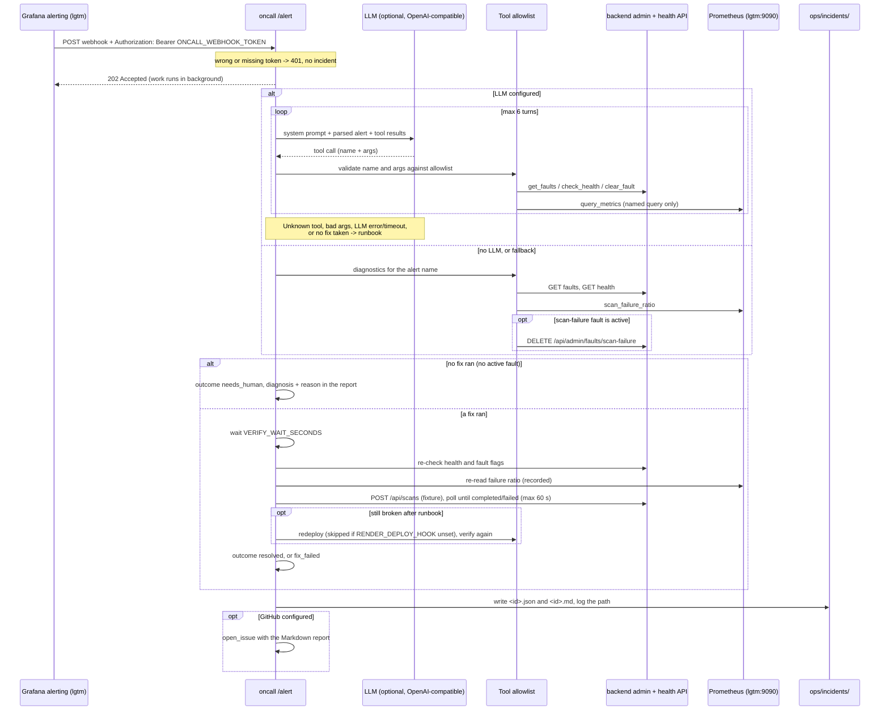

# On-call responder agent

The `oncall` service wakes up when Grafana fires an alert, finds the cause,
fixes it if the cause is one it knows, checks that the fix worked from a
user's point of view, and writes an incident report. If there is nothing it
can fix, it says so (`needs_human`) instead of claiming success.

Code: `oncall/` (its own uv project; FastAPI + httpx, no LLM SDK).
Runbook it follows: `ops/runbooks/scan-failure-rate.md`.

## Flow



## Tools (fixed allowlist)

The model gets these tool specs and nothing else. The server validates every
call: unknown names, extra or missing arguments, and values outside the
allowed set are rejected, and the agent falls back to the runbook.

| Tool | Args | What it does |
|---|---|---|
| `get_alert` | none | Parsed alert: name, status, severity, service, start time, numeric values, summary |
| `query_metrics` | `name`: `scan_failure_ratio`, `scan_rate`, `scan_duration_p95` | Runs a fixed PromQL query; returns numbers only |
| `get_faults` | none | Names of active injected faults |
| `check_health` | none | `/api/health` status, version, HTTP code |
| `clear_fault` | `name`: `scan-failure` | `DELETE /api/admin/faults/scan-failure`, only if `get_faults` lists it as active right now; otherwise returns `{"cleared": null, "rejected": "fault scan-failure is not active"}` and changes nothing |
| `redeploy` | none | POST the Render deploy hook (same image = restart); skipped if unset |
| `rollback` | none | `workflow_dispatch` of `deploy.yml` with `ROLLBACK_TAG`; skipped if unset |

`open_issue` and the verification scan are not offered to the model. The
agent runs them itself, after the fix.

The active-fault check for `clear_fault` is enforced server-side in
`oncall/oncall/tools.py`, so a model that asks to clear a fault that is not
on gets a rejection as its tool result. A rejected call does not count as a
fix.

The model cannot write PromQL, choose URLs, or pick a rollback tag. Those are
fixed in code or config.

## Runbook fallback

Used when no LLM is configured, or when the LLM errors, times out, asks for a
tool or argument that is not allowed, hits the step cap, or finishes without a
fix. A fresh clone with no key still fixes the demo incident this way.

| Alert | Actions, in order |
|---|---|
| `ScanFailureRateHigh` | `get_alert`, `query_metrics(scan_failure_ratio)`, `get_faults`, `check_health`; then `clear_fault(scan-failure)` only if `get_faults` listed it; if verification fails, `redeploy` |
| any other | diagnostics only, outcome `needs_human` |

Resolved alerts are logged and take no action.

## Outcomes

| Outcome | When |
|---|---|
| `resolved` | A fix ran and verification passed |
| `fix_failed` | A fix ran (and the `redeploy` escalation, if configured), but verification still fails |
| `needs_human` | No fix ran: no active fault (real scan failures), an unknown alert, or every fix was skipped or rejected. The report has a `reason` line and a `diagnosis` block (health, active faults, failure ratio). Nothing was changed |
| `alert_resolved` | Grafana's `resolved` notification; logged only, no report |

Every outcome except `alert_resolved` writes a report and opens a GitHub
issue if configured.

## Verification

After a fix, the agent waits `VERIFY_WAIT_SECONDS`, then checks:

- `/api/health` returns 200 with `status: ok`
- `GET /api/admin/faults` shows no active `scan-failure`
- one real scan of the bundled fixture, submitted through the public API
  (`POST /api/scans` with target `oncall-verify`, stdio command
  `vulnerable-demo`) and polled every 2 s for up to `VERIFY_SCAN_TIMEOUT`
  seconds, finishes `completed`

All three must hold for `resolved`, else `fix_failed`. The report records
only the scan id and status, never its error text. The failure ratio is
recorded but not required to drop, because it is a 5-minute rate and stays
high for a few minutes after the cause is gone. Grafana sends `resolved` when
it does.

## Webhook authentication

`POST /alert` requires `Authorization: Bearer <ONCALL_WEBHOOK_TOKEN>`,
compared in constant time (`hmac.compare_digest`). A missing or wrong token,
or no token configured on the server, returns 401 before the body is read,
and no incident is created.

Grafana sends the header from the contact point in
`ops/grafana/alerting.yaml` (`authorization_scheme: Bearer`,
`authorization_credentials: $ONCALL_WEBHOOK_TOKEN`). Grafana expands
`$ONCALL_WEBHOOK_TOKEN` from the lgtm container's environment when it loads
the provisioning file; compose passes the same value to `lgtm` and `oncall`
(default `local-oncall-token`). Checked on `grafana/otel-lgtm:0.36.0`: the
provisioned contact point shows `authorization_credentials: [REDACTED]`, a
real alert is accepted with 202, and a `curl` without the token gets 401.

## Data boundary

Brief Section 2, item 1: target-server data never reaches an LLM. The agent
sees only:

- the alert payload, reduced to name, status, severity, service, start time,
  numeric values, and a 200-character summary (URLs and fingerprints dropped)
- metric numbers (labels dropped)
- fault flag names whose value is `true`
- health `status`, `version`, and HTTP code

Each tool builds a small typed result; it never passes a raw response through.
The agent has no tool that reads scans, targets, or findings, so tool
descriptions, commands, URLs, and finding text cannot reach the model.
Enforced by:

- `oncall/tests/test_agent.py::test_llm_never_sees_target_data`: the fake
  backend and Prometheus return target-like strings and a prompt injection;
  the test asserts none appear in any request sent to the LLM.
- Semgrep rule `oncall-no-scanner-target-data-import` in
  `security/semgrep/rules/no-llm-on-untrusted-mcp-data.yaml`: `oncall/` may
  not import backend code or the MCP SDK.
- The agent does not query Loki. Logs are not needed for this incident, and
  skipping them removes a path for free text to reach the model.

What goes to the LLM provider: `security/ai-tool-data-policy.md`.

## Configuration

Set in `.env` (see `.env.example`). Compose passes them to the service.

| Variable | Default | Purpose |
|---|---|---|
| `SCANNER_URL` | `http://backend:8000` | Backend base URL |
| `PROMETHEUS_URL` | `http://lgtm:9090` | Prometheus HTTP API |
| `ADMIN_TOKEN` | `local-admin-token` (compose) | Bearer token for `/api/admin/*` |
| `ONCALL_WEBHOOK_TOKEN` | `local-oncall-token` (compose) | Shared secret for `POST /alert`; also passed to `lgtm` for the contact point. Empty in the service = every `/alert` gets 401 |
| `VERIFY_WAIT_SECONDS` | `15` | Wait before verification |
| `VERIFY_SCAN_TIMEOUT` | `60` | Max seconds to wait for the verification scan |
| `MAX_STEPS` | `6` | Cap on LLM turns per incident |
| `INCIDENTS_DIR` | `/app/ops/incidents` | Report output (mounted to `ops/incidents/`) |
| `LLM_BASE_URL` | empty | OpenAI-compatible base, e.g. `https://api.openai.com/v1` |
| `LLM_API_KEY` | empty | Provider key |
| `LLM_MODEL` | empty | Model name; all three LLM vars must be set to use the LLM |
| `RENDER_DEPLOY_HOOK` | empty | Enables `redeploy` |
| `ONCALL_GITHUB_TOKEN` | empty | Becomes `GITHUB_TOKEN` in the container; enables `rollback` and `open_issue` |
| `ONCALL_GITHUB_REPOSITORY` | empty | `owner/repo` |
| `ROLLBACK_TAG` | empty | Known-good image tag (commit SHA) for `rollback` |

The GitHub variables use an `ONCALL_` prefix in `.env` so a `GITHUB_TOKEN` in
your shell is never passed in by accident.

## Run the demo

```bash
docker compose up --build -d backend db lgtm oncall

# A. Fixable: inject the fault, submit scans, let Grafana fire (about 1-2 min)
scripts/trigger-alert.sh
# -> outcome resolved: fault cleared, verification scan completed

# B. Not fixable: no fault, scans fail for a real reason
for i in $(seq 1 8); do
  curl -s -o /dev/null -XPOST -H 'Content-Type: application/json' \
    -d '{"target":{"name":"broken","transport":"stdio","command":"/nonexistent/server"}}' \
    http://127.0.0.1:8000/api/scans
done
# -> outcome needs_human: nothing cleared, diagnosis in the report

# C. Skip the wait: post a Grafana-format payload yourself (needs the token)
curl -XPOST -H 'Content-Type: application/json' \
  -H 'Authorization: Bearer local-oncall-token' \
  -d '{"status":"firing","alerts":[{"status":"firing","labels":{"alertname":"ScanFailureRateHigh","service":"scanner-backend","severity":"page"},"values":{"A":0.8}}]}' \
  http://127.0.0.1:8080/alert
# Without the Authorization header: 401, no incident.

# Check the result
docker compose logs oncall | grep incident
ls ops/incidents/
```

Run B after the alert from A has resolved (Grafana sends `resolved` about 5
minutes after the last failed scan); while an alert keeps firing, Grafana
re-sends only every hour.

Samples from real Grafana-triggered runs (2026-10-17, `grafana/otel-lgtm:0.36.0`):

- `ops/incidents/20261017T160850Z-ScanFailureRateHigh-bc7a2c.md`: case A,
  fault cleared, verification scan 13 `completed`, outcome `resolved`
- `ops/incidents/20261017T161450Z-ScanFailureRateHigh-bdc906.md`: case B, 8
  failing `/nonexistent/server` scans, no fault, nothing cleared, outcome
  `needs_human`

`ops/incidents/20261016T222020Z-ScanFailureRateHigh-ceb72b.md` is an older
run from before these checks existed (#25).

## Tests

`cd oncall && uv run pytest` covers webhook parsing and token auth (401 for a
missing, wrong, or unconfigured token), the allowlist, the LLM client against
a fake OpenAI-compatible server (httpx `MockTransport`), fallback on unknown
tools, bad args, errors, and the step cap, the data boundary, `clear_fault`
rejected with no active fault (runbook and LLM), `needs_human` with
diagnosis, the verification scan (completed, failed, timeout), and an
integration test that posts a Grafana payload to the real app with a fake
backend and Prometheus.
